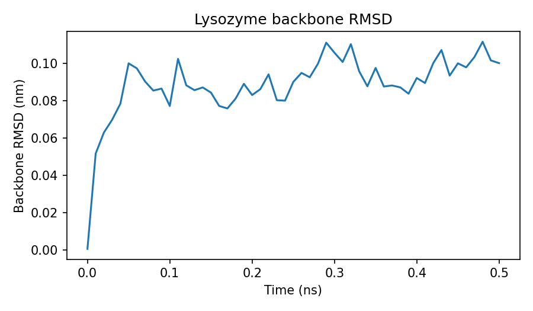
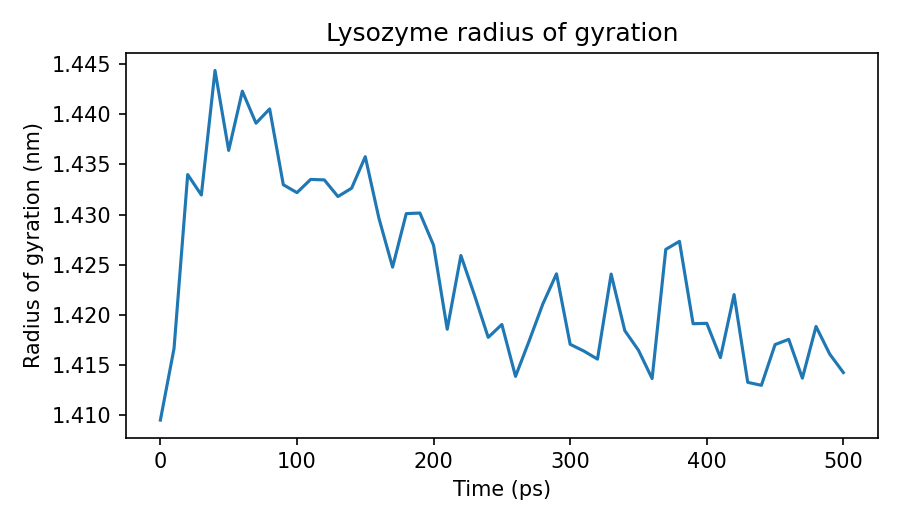
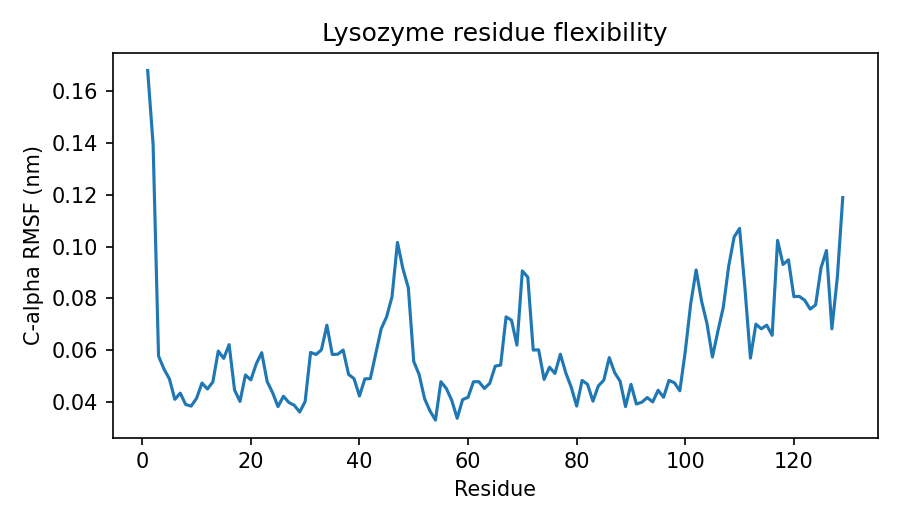

# Molecular dynamics of lysozyme (PDB 1AKI) with GROMACS

A complete, standard molecular dynamics (MD) workflow for hen egg-white lysozyme in water,
from structure preparation to analysis of protein stability and flexibility.

## Workflow

| Step | What was done |
|---|---|
| Structure | PDB 1AKI, crystal water removed |
| Topology | OPLS-AA force field, SPC/E water; 129 residues, 1960 atoms, net charge +8 |
| Solvation | Cubic box, 1.0 nm protein-edge distance; 10,644 water molecules |
| Ions | 8 Cl⁻ added to neutralise the system |
| Energy minimisation | Steepest descent, converged in 831 steps (Fmax < 1000 kJ/mol/nm) |
| NVT equilibration | 100 ps at 300 K, protein position-restrained |
| NPT equilibration | 500 ps at 1 bar, protein position-restrained |
| Production run | 500 ps, unrestrained, 300 K, 1 bar, 2 fs time step |
| Analysis | Backbone RMSD, C-alpha RMSF, radius of gyration (GROMACS tools + Python) |

## Results

**Stability.** The backbone RMSD rose during the first ~50 ps and then plateaued
(mean over the second half: 0.097 nm), showing that the structure stayed close to the crystal structure.



**Compactness.** The radius of gyration stayed at 1.424 ± 0.009 nm, so the protein remained compact and folded.



**Flexibility.** The C-alpha RMSF was highest at the N-terminus (residues 1–2, up to 0.168 nm)
and the C-terminus (residue 129, 0.119 nm), and in the loop around residues 109–110 (~0.105 nm).
The core of the protein was the most rigid (~0.04 nm).



## Limitations

- The production run is short (500 ps), so only fast, local motions are sampled.
  Longer runs and replicate simulations would be needed for robust conclusions.
- Simulations were run on a laptop CPU (GROMACS 2025.4, ~8 ns/day).

## Repository structure

input/ PDB structure (original and without crystal water)
mdp/ GROMACS parameter files
sim/ topology, structures and run files
analysis/ GROMACS analysis output (.xvg)
scripts/ Python plotting script
plots/ figures


Large trajectory and binary files (.xtc, .trr, .tpr, .edr, .cpt) are not tracked.

## Reproduce the plots

```bash
python3 scripts/plot_analysis.py
```

## Acknowledgement

Workflow and parameter files based on J. A. Lemkul's GROMACS tutorial "Lysozyme in Water"
(http://www.mdtutorials.com/gmx/lysozyme/).

Author: Vimala Valli Vempati
